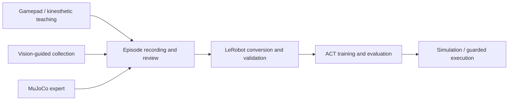

# OpenArm Embodied Systems

**Demonstration-driven manipulation · Reproducible data · Guarded policy execution**

A research monorepo for OpenArm manipulation: gamepad and kinesthetic teaching, multi-camera demonstration collection, LeRobot dataset preparation, ACT experiments, and execution-time checks.

> **Release scope:** the CPU quickstart below is validated without ROS or robot hardware. Teaching, vision collection, and real-robot execution are included as research source snapshots with additional dependencies. This release does not claim portable, validated hardware deployment or reproduced training results.



## Start without a robot

Linux x86_64, Python 3.12, and `uv` are used for the tested baseline. Clone normally; upstream sources are included and no recursive submodule checkout is needed.

```bash
git clone https://github.com/Asukaandmeaaa/openarm-embodied-systems.git
cd openarm-embodied-systems
uv sync --frozen
make test
make smoke
```

`make test` runs an explicit hardware-free suite covering expert contracts, recording transactions, task success gates, command ownership, and speed-limit configuration. `make smoke` loads the included MuJoCo scene, advances simulation, and validates the 16-axis observation. Neither target launches hardware nodes, opens CAN, or accesses cameras.

The root `uv.lock` pins the CPU baseline. Optional LeRobot/ACT and camera profiles live in `requirements/`; they are not validated by the CPU quickstart. Other entry points may require machine-specific paths, external workspaces, hardware configuration and additional fixtures. Running all historical tests is outside the validated CPU baseline.

## Components

| Source | Purpose |
| --- | --- |
| `openarm_cube_pick_expert/` | IK candidates, task FSM, trajectory recording, action guard |
| `openarm_cube_into_black_box_expert/` | Placement task and ordered success criteria |
| `integrations/kinesthetic/` | Gamepad/drag teaching library, ROS recorder source, launch/config examples |
| `vision_grasp_baseline/` | Perception, collection service, episode review and ACT export |
| `scripts/act_trial/` | Policy queues, execution profiles, timing, feedback and command guards |
| `scripts/control_ownership/` | Single-writer control authority and DDS policy tooling |
| `scripts/home_replay/`, `scripts/expert_replay/` | Recorded motion validation and replay integration |
| `sim/`, `configs/`, `tests/` | Simulation scenes, experiment settings and regression tests |
| `official/` | Upstream source snapshots, including local integration modifications |

The existing directory layout is preserved to retain relative imports and resource references. A separate teaching source snapshot is included because the original workspace depended on it outside this repository.

## Reproduction and evidence

The commands above define the validated CPU baseline. See [NOTICE](NOTICE.md) for upstream attribution.

Historical experiment notes, raw demonstrations, trained weights, runtime reports and control credentials are not distributed in this source release. Prior experiment metrics are not fresh-clone benchmarks.

## Real hardware

Physical workflows require the matching ROS 2/OpenArm stack, calibrated robot model, current joint limits, camera configuration and locally generated control credentials. Historical launch commands contain machine-specific paths and should be adapted and reviewed before use. Guards are engineering checks, not a safety certification; their behavior varies by execution profile.

No installation or default CI target enables motors. Do not use the CPU smoke result as evidence of physical safety or ACT task success.

## Attribution and license

This project builds on OpenArm, Dora, LeRobot and MuJoCo. See [NOTICE](NOTICE.md), [third-party notices](THIRD_PARTY_NOTICES.md), and the licenses retained in each upstream tree. The root [Apache-2.0 license](LICENSE) covers this project's original contributions; upstream components retain their own terms.
